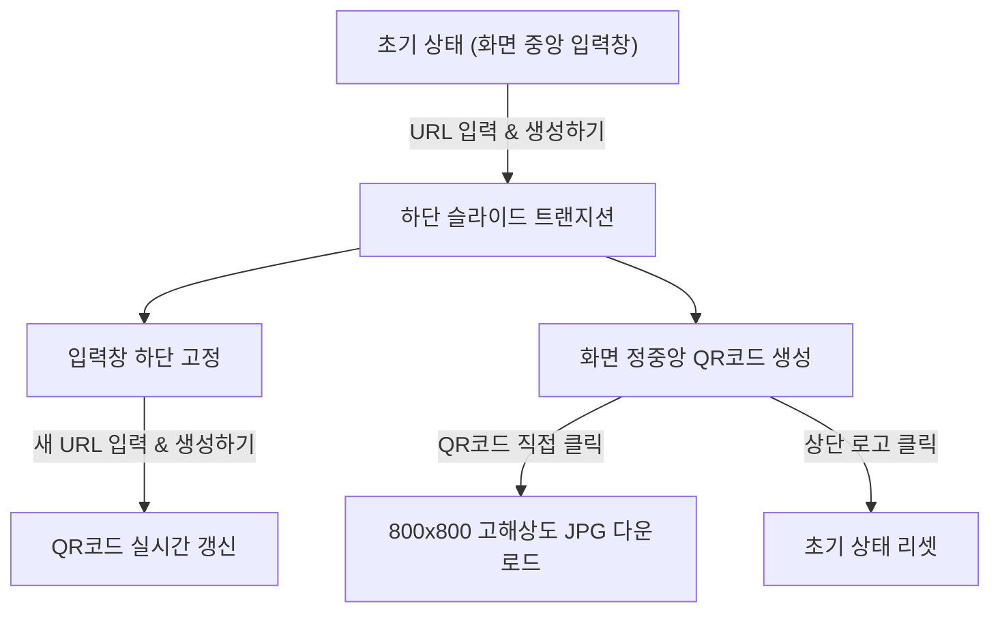

# URL2QR 웹 사이트 구현 계획 (Implementation Plan)

## 1. 프로젝트 개요
사용자가 입력한 웹 주소(URL)를 즉시 스캔 가능한 QR코드로 변환하고, 생성된 QR코드를 고화질 JPG 이미지로 다운로드할 수 있는 모던 인터랙티브 웹 애플리케이션입니다.

---

## 2. 주요 요구사항 및 구현 목표
1. **상단 좌측 로고 배치**: 화면 상단 좌측에 `img/logo.png` 이미지를 자연스럽게 배치하고, 클릭 시 초기 화면으로 복귀하는 홈 버튼 기능 제공.
2. **중앙 심플 입력창**: 초기 접속 시 화면 정중앙에 깔끔하고 미니멀한 검색형 URL 입력 인터페이스 제공.
3. **위치 전환 트랜지션 애니메이션**:
   - URL 입력 후 확인(생성하기) 버튼 또는 Enter 키 입력 시, 중앙 입력창이 화면 하단으로 부드럽게 슬라이드 이동.
   - 동시에 화면 정중앙에 고화질 QR코드 결과 카드가 스케일업 애니메이션과 함께 등장.
4. **QR코드 클릭 시 JPG 다운로드**:
   - 생성된 QR코드를 클릭하면 JPEG 포맷 특유의 투명 배경 검은색 채움 결함 없이 순백색(#FFFFFF) 배경이 적용된 800×800 고해상도 JPG 파일로 즉시 저장.
5. **로고 연계 화사한 톤앤매너 & 마우스 인터랙티브 그라데이션**:
   - 로고의 앰버 골드(`#FFC000`)에 최적화된 밝고 따뜻한 톤(아이보리, 앰버, 피치)과 프로스티드 글래스(Glassmorphism) 적용.
   - 마우스 커서의 물리적 좌표에 따라 빛의 위치(Glow Orbs)와 색조(Hue 38°~54°)가 실시간으로 변조되는 유려한 앰비언트 배경 구현.

---

## 3. 기술 스택 및 아키텍처
- **프론트엔드**: HTML5 (시맨틱 웹 표준, 접근성 준수)
- **스타일링**: CSS3 (CSS Variables, Flexbox/Grid, Glassmorphism, GPU 가속 트랜지션)
- **자바스크립트**: Vanilla JavaScript (ES6+, RequestAnimationFrame + Lerp 보간 물리 엔진)
- **QR 생성 엔진**: `qrcode-generator` (한글 UTF-8, 영문, 특수문자, 긴 URL 100% 무결점 지원)
- **이미지 프로세싱**: HTML5 Canvas 2D API (JPG 전사용 오프스크린 캔버스 렌더링)

---

## 4. 컴포넌트 설계 및 워크플로우

---

## 5. 단계별 검증 및 테스트 계획
1. **URL 정규화 검증**: `http://` 또는 `https://` 누락 시 자동 보완 동작 확인.
2. **다국어 및 한글 UTF-8 검증**: 한글 URL, 검색어 파라미터가 포함된 URL에서 오류 없이 QR코드가 생성되는지 검증.
3. **JPG 다운로드 품질 검증**: 투명 배경 왜곡 없이 순백색 여백과 선명한 모듈이 포함된 `.jpg` 파일 생성 확인.
4. **마우스 인터랙션 성능 검증**: 60fps/120fps 화면에서 끊김 없이 부드러운 감속 보간(Lerp) 렌더링 확인.
5. **반응형 뷰포트 검증**: 모바일, 태블릿, 높이가 낮은 노트북 화면에서도 레이아웃 겹침 없는 최적화 확인.
